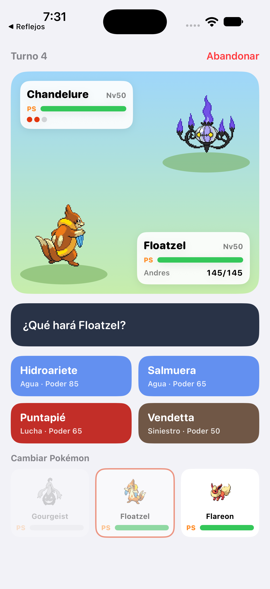
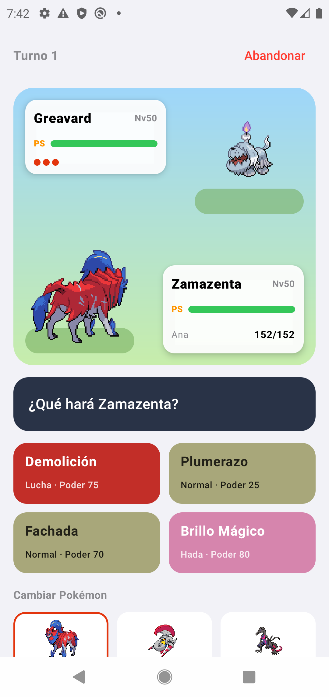
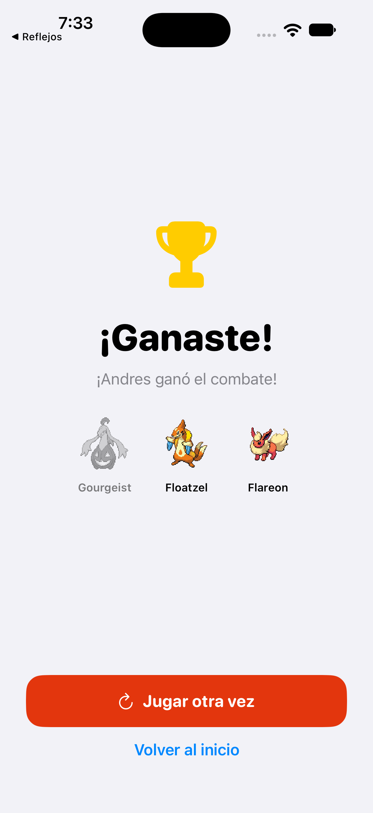

# Arena Pokémon

Juego en línea para dos jugadores. El servidor en Node.js consulta la [PokeAPI](https://pokeapi.co), le da a cada jugador **10 Pokémon al azar**, cada uno elige **3** y pelean por turnos con **ataques reales** de la PokeAPI. Hay dos apps nativas, sin frameworks multiplataforma, y pueden jugar entre sí:

| Carpeta | Tecnología |
|---|---|
| `servidor/` | Node.js 24, Express 5 y WebSockets (`ws`) |
| `ios/` | Swift y SwiftUI, iOS 17 o superior, sin dependencias |
| `android/` | Kotlin y Jetpack Compose; OkHttp para el WebSocket |

Una partida iPhone contra Android pasa siempre por el mismo servidor, que es quien decide el resultado de cada turno.

<p align="center">
  
  
  
</p>

## Cómo correrlo

1. **Enciende el servidor**. Necesitas [Node.js](https://nodejs.org) 22 o posterior y conexión a internet para la PokeAPI:

   ```bash
   git clone https://github.com/andres-ruhell/ArenaPokemon.git
   cd ArenaPokemon/servidor
   npm install
   npm start
   ```

2. **iOS**: abre `ios/ArenaPokemon.xcodeproj` en Xcode, elige un simulador de iPhone y pulsa **Run ▶**. El servidor por defecto es `127.0.0.1:3000`. Para instalarla en un iPhone, elige tu cuenta en *Signing & Capabilities*.
3. **Android**: abre la carpeta `android/` en Android Studio, elige un emulador y pulsa **Run ▶**. El servidor por defecto es `10.0.2.2:3000`, que es la dirección de la computadora vista desde el emulador. Para un celular Android sin compilar nada, descarga `ArenaPokemon.apk` desde [Releases](https://github.com/andres-ruhell/ArenaPokemon/releases/latest) y ábrela; Android te pedirá permiso para instalar apps de origen desconocido.
4. Escribe tu nombre en cada app y pulsa **Buscar rival**. El servidor empareja a los dos primeros jugadores que estén esperando.

Si solo tienes una app abierta, pulsa **Jugar contra la CPU**: el servidor te pone de rival a su propia CPU al instante. También puedes usar el bot de la terminal, que entra a la fila como si fuera otro jugador:

```bash
cd servidor
node bot.js Misty
```

**Teléfonos físicos**: conéctalos a la misma red Wi‑Fi que la computadora del servidor y escribe en el campo **Servidor** la IP que muestra la terminal al encender el servidor (por ejemplo `192.168.1.20:3000`).

## Cómo se juega

1. **Elegir equipo**: cada jugador recibe sus propios 10 Pokémon al azar (de los 1025 que hay) y toca 3. Al entrar a esta pantalla, una Pokébola pequeña aparece al centro y se sacude tres veces, como al atrapar un Pokémon. Luego baja hasta asomarse en el borde inferior (se ven sus 3/5 de arriba) y su botón pasa de blanco a un verde blancuzco con un resplandor. Los 10 Pokémon salen de detrás de ella en orden: suben, se abren en curva hacia su lugar y se acomodan con un pequeño rebote. Al final la Pokébola se esconde y sube el botón **¡Al combate!** (alrededor de 3 s). Ambas apps usan los mismos tiempos y curvas. En iOS se omite si está activado *Reducir movimiento*.
2. **Combate**: cada turno, los dos eligen a la vez entre atacar con uno de los 4 ataques del Pokémon activo o cambiar de Pokémon. Cuando ambos eligieron, el servidor resuelve el turno y las apps lo narran.
3. **Fin**: pierde quien se queda sin Pokémon. Si un jugador abandona o se desconecta, gana el otro.

**Contra la CPU** (`servidor/cpu.js`): la CPU elige 3 Pokémon al azar entre los 5 de sus opciones con más stats. En cada turno calcula qué ataque haría más daño (poder × precisión × STAB × efectividad de tipos contra tu Pokémon) y lo usa el 75 % de las veces; el resto elige al azar, para que se le pueda ganar. Si ninguno de sus ataques afecta a tu Pokémon, cambia a un compañero que sí pueda.

Reglas del combate, en `servidor/combate.js`:

- Todos los Pokémon están al **nivel 50**: `PS = base + 60` y las demás stats son `base + 5`.
- **Daño**: `floor(floor(22 × poder × A / D) / 50) + 2`. A y D son físicos o especiales según el ataque. Luego se multiplica por:
  - **STAB** ×1.5 si el ataque es del mismo tipo que el Pokémon.
  - **efectividad** de tipos (×2, ×0.5 o ×0), tomada de la PokeAPI.
  - **golpe crítico** ×1.5, con probabilidad de 1/24.
  - un factor aleatorio entre 0.85 y 1.
- Los ataques pueden **fallar** según su precisión.
- **Orden del turno**: primero los cambios; después ataca el Pokémon más veloz. Un Pokémon debilitado ya no ataca, y al final del turno entra automáticamente el siguiente que siga vivo.
- **Ataques**: el servidor elige 4 ataques de daño al azar de la lista real de cada Pokémon, da prioridad a los de su tipo y los muestra con su nombre en español. No usa ataques de más de 120 de poder. Si un Pokémon no tiene ataques de daño (Ditto, por ejemplo), usa *Forcejeo*.

## Protocolo WebSocket

La conexión es `ws://<servidor>:3000/arena` y todos los mensajes son JSON con un campo `tipo`.

| Dirección | `tipo` | Contenido |
|---|---|---|
| app → servidor | `unirse` | `{nombre}`: entra a la fila de espera |
| app → servidor | `jugarCPU` | `{nombre}`: partida inmediata contra la CPU del servidor |
| servidor → app | `esperando` | todavía no hay rival |
| servidor → app | `partida` | `{nombre, rival, opciones: [10 Pokémon]}` |
| app → servidor | `elegirEquipo` | `{ids: [3 ids]}` |
| servidor → app | `esperandoRival` | tu equipo está listo y falta el del rival |
| servidor → app | `inicioCombate` | `{eventos, estado}` |
| app → servidor | `accion` | `{accion: "atacar", movimiento: 0-3}` o `{accion: "cambiar", indice: 0-2}` |
| servidor → app | `accionRecibida` | se guardó tu acción y se espera la del rival |
| servidor → app | `turno` | `{eventos, estado}` |
| servidor → app | `fin` | `{ganador, eventos, estado}` |
| servidor → app | `error` | `{mensaje}` |

- `estado` llega desde la perspectiva de quien lo recibe: `yo` trae tu equipo completo con sus ataques, y `rival` solo trae su Pokémon activo y cuántos le quedan vivos.
- Cada evento trae un `texto`, por ejemplo "¡Es muy eficaz!". Los eventos que pasan en el campo también traen `lado` (`yo` o `rival`) y alguno de estos datos:
  - `pokemon`: el que entra al campo.
  - `efecto: "ataque"` con el `tipo` del ataque: el atacante se lanza hacia el rival.
  - `efecto: "golpe"` con `ps`, `danio`, `tipo`, `efectividad` y `critico`: el golpeado parpadea, se sacude y aparece el número de daño mientras baja la barra.
  - `efecto: "fallo"` o `"inmune"`: aparece "Falló" o "Sin efecto".
  - `efecto: "debilitado"`: el Pokémon cae y desaparece.

## Animaciones del combate

Las apps narran cada turno evento por evento. En cada ataque:

1. El atacante toma impulso y se lanza hacia el rival.
2. El rival parpadea y se sacude, y un anillo del color del tipo del ataque se expande sobre él.
3. Aparece el daño flotando ("−48"), sube y se desvanece mientras la barra de PS baja. El número es blanco si el daño es normal, amarillo y más grande si es muy eficaz, rojo con "¡!" si es crítico y gris si es poco eficaz. Si el ataque falla o no afecta, aparece "Falló" o "Sin efecto".
4. Si los PS llegan a 0, el Pokémon cae y desaparece justo después.

## Código

- **Servidor**:
  - `servidor.js`: Express y WebSocket.
  - `arena.js`: emparejamiento, partidas y validación de mensajes.
  - `combate.js`: reglas del combate.
  - `pokeapi.js`: consultas a la PokeAPI con caché.
  - `cpu.js`: la CPU. Recibe los mismos mensajes que una app y contesta igual que una.
  - `bot.js`: rival de prueba desde la terminal.
- **iOS** (`ios/ArenaPokemon/`):
  - `ClienteArena.swift`: `URLSessionWebSocketTask`, el estado de la partida y la narración.
  - `Modelos.swift`: los datos del protocolo.
  - Las vistas: `InicioView`, `BuscandoView`, `SeleccionView`, `CombateView` y `FinView`.
- **Android** (`android/app/src/main/java/com/ibero/arenapokemon/`):
  - `ArenaViewModel.kt`: WebSocket con OkHttp y el estado de la partida.
  - `Modelos.kt`: los datos del protocolo, leídos con `org.json`.
  - `Pantallas.kt` y `CombatePantalla.kt`: las pantallas en Compose.
  - `Componentes.kt`: barra de PS, colores de tipo y carga de sprites con OkHttp.

## Pruebas realizadas

- `cd servidor && node --test`: 14 pruebas.
  - 9 del combate: fórmula de daño, efectividad, inmunidad, orden por velocidad, cambio antes de ataque, fallo por precisión, cambio automático, ganador y los datos que las apps usan para animar.
  - 5 de la CPU: equipo entre los más fuertes, ataque más efectivo, precisión, cambio cuando nada afecta y errores al azar.
- **Dos bots** (`node bot.js Ash` y `node bot.js Misty`): partida completa de 18 turnos contra la PokeAPI real.
- **Contra la CPU**: partidas completas desde el bot (`node bot.js Ash --cpu`), desde iOS (ganó la CPU) y desde Android (ganó el jugador). "Jugar otra vez" repite el modo, y abandonar a media partida la cierra sin errores.
- **iOS** en el simulador de iPhone 18 Pro (iOS 27): partida completa contra el bot, con cambio manual, cambio automático e inmunidad de tipo, y victoria.
- **Android** en el emulador Pixel 4 (API 29): partida completa contra el bot.
- **iOS contra Android** en la misma partida. Los dos narran el mismo turno. Al pulsar **Abandonar** en iOS, Android muestra "¡Ganaste! Andres abandonó la partida."
- **Animaciones de ataque**: grabadas en iOS y en Android durante partidas contra la CPU. Se ven la embestida, el parpadeo con el anillo del tipo y el número de daño, blanco en un golpe normal y amarillo en uno muy eficaz.

Las capturas están en `capturas/`. Los archivos `*-0-animacion-entrada.png` muestran, cuadro por cuadro, cómo salen los Pokémon de la Pokébola en cada app; `ios-6-ataque.png`, `ios-7-ataque-muy-eficaz.png` y `android-5-ataque.png` muestran los ataques.

## Compilar desde la terminal

```bash
# iOS (después de modificar project.yml: xcodegen generate)
cd ios && xcodebuild -project ArenaPokemon.xcodeproj -scheme ArenaPokemon -destination 'platform=iOS Simulator,name=iPhone 18 Pro' build

# Android (con el JDK de Android Studio)
cd android && JAVA_HOME="/Applications/Android Studio.app/Contents/jbr/Contents/Home" ./gradlew assembleDebug
```

La APK queda en `android/app/build/outputs/apk/debug/app-debug.apk`.

## Créditos

Proyecto escolar sin fines de lucro. Los datos, ataques y sprites vienen de la [PokeAPI](https://pokeapi.co). Pokémon es una marca de Nintendo, Game Freak y The Pokémon Company.
